<div dir="rtl">

# اقساط — ربات تلگرام و مینی‌اپ مدیریت اقساط و پرداخت‌ها

ربات تلگرام خصوصی (برای خودتان و چند نفر محدود) برای یادآوری اقساط، مدیریت پرداخت‌های ماهانه و برنامه‌ریزی «از کدام دریافتی، کدام قسط را کنار بگذارم»؛ همراه با یک **مینی‌اپ گرافیکی** داخل تلگرام.


- روی **هاست اشتراکی سی‌پنل** اجرا می‌شود (Webhook + Cron) — بدون نیاز به سرور مجازی، Node.js یا Composer.
- تقویم **شمسی**، مبالغ به **تومان**، رابط کاملاً فارسی و راست‌به‌چپ.

## تصاویر

| خانه | درآمد و برنامه | گزارش ماهانه | آینده |
|:-:|:-:|:-:|:-:|
| 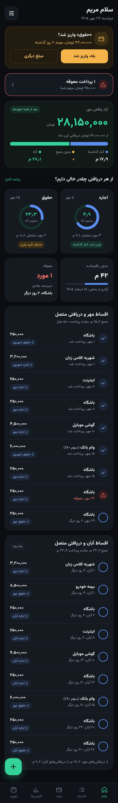 | 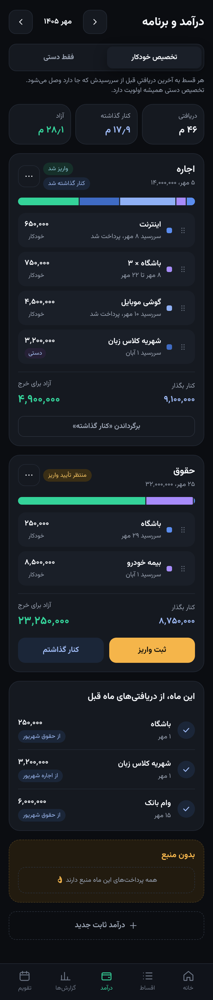 | 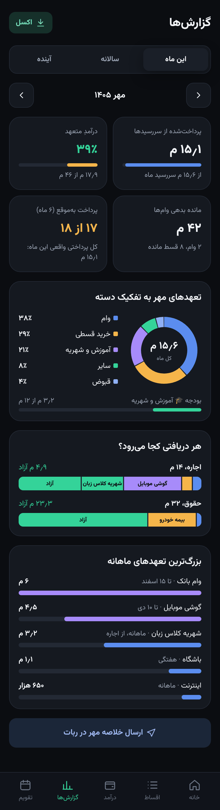 | 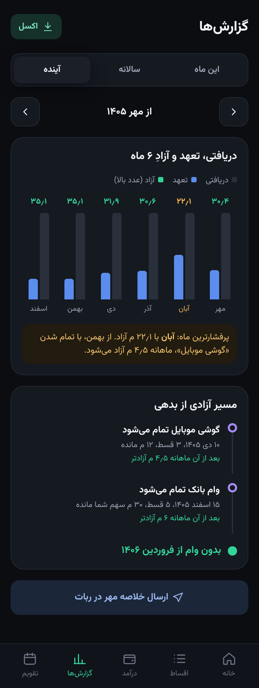 |
| **اقساط** | **جزئیات وام** | **تقویم شمسی** | **ثبت واریز** |
| 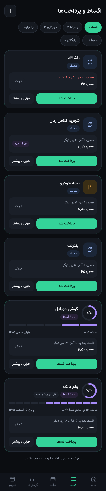 | 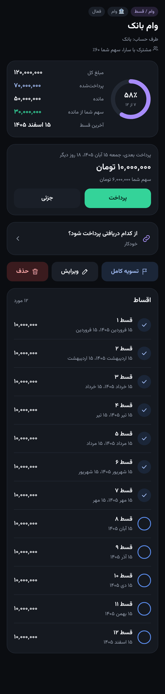 | 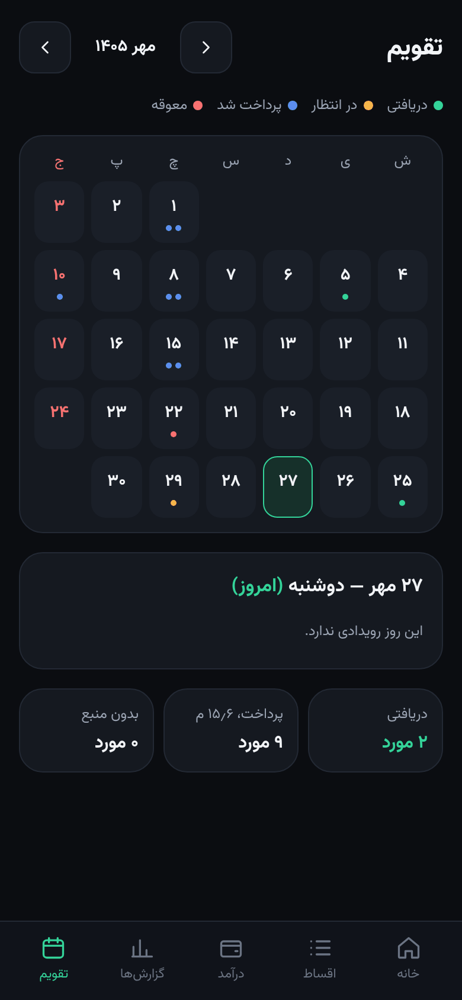 | 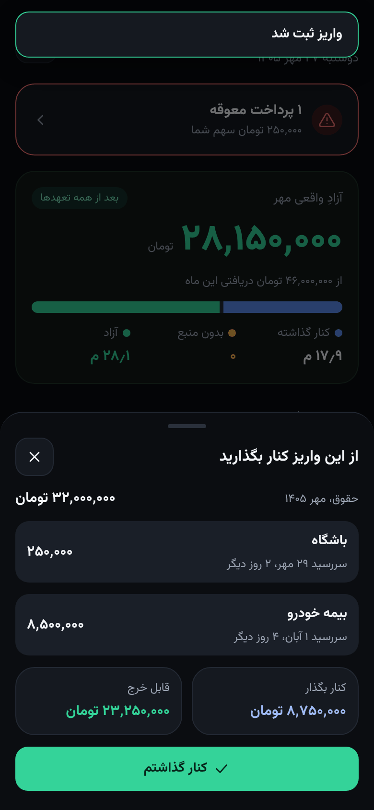 |
| **افزودن** | **گزارش سالانه** | **تم روشن** | **تنظیمات** |
| 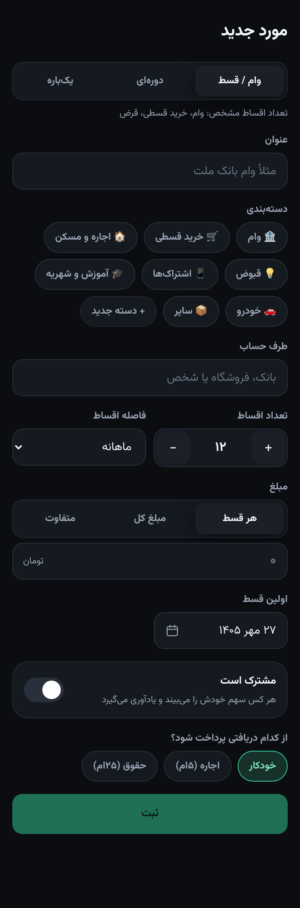 | 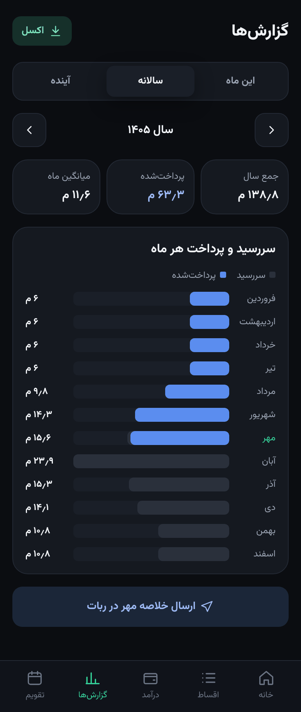 | 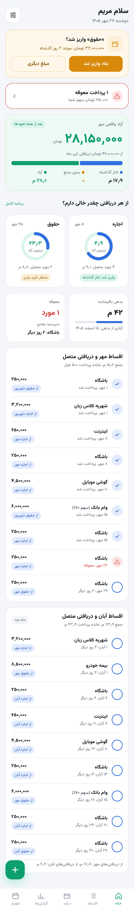 | 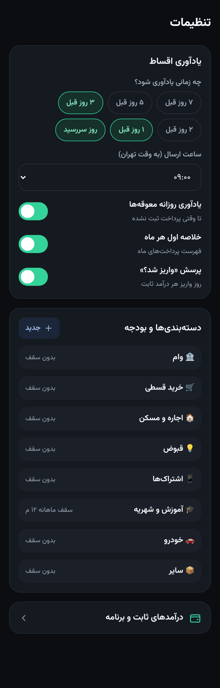 |

<sub>داده‌های تصاویر نمونه هستند.</sub>

## امکانات

**اقساط و پرداخت‌ها**
- سه نوع: **وام / قسطی** (تعداد اقساط مشخص)، **دوره‌ای** (ماهانه، هفتگی، سالانه، هر چند ماه) و **یک‌باره**
- اقساط مساوی، تقسیم مبلغ کل، یا مبالغ متفاوت (`5000000*6`)
- ثبت اقساطی که قبلاً پرداخت شده‌اند، پرداخت کامل/جزئی، لغو پرداخت، تسویه زودهنگام، توقف/ادامه، ویرایش تک‌تک اقساط
- **اقساط مشترک** بین دو نفر با درصد سهم؛ هر نفر سهم خودش را می‌بیند و پرداخت‌ها به طرف مقابل اطلاع داده می‌شود
- دسته‌بندی دلخواه با **سقف بودجه ماهانه** و هشدار عبور از بودجه

**درآمد و برنامه‌ریزی**
- ثبت درآمدهای ثابت ماهانه (مبلغ و روز واریز) و مبلغ واقعی هر ماه
- تخصیص **خودکار یا دستی** اقساط به دریافتی‌ها (کشیدن و رها کردن در مینی‌اپ)
- «**آزادِ واقعی ماه**» و مانده آزاد هر دریافتی بعد از کنار گذاشتن اقساط
- پرسش «**واریز شد؟**» در روز واریز و فهرست «از این واریز برای کدام قسط چقدر کنار بگذار»

**یادآوری‌ها** (قابل تنظیم برای هر کاربر)
- چند مرحله قبل از سررسید (۷، ۵، ۳، ۲، ۱ روز قبل و روز سررسید) در ساعت دلخواه
- یادآوری روزانه معوقه‌ها، خلاصه اول هر ماه، و پرسش واریز درآمد

**گزارش‌ها**
- ماهانه به تفکیک دسته و نوع، سالانه، پیش‌بینی ۶ تا ۱۲ ماه آینده، پرفشارترین ماه
- مسیر آزادی از بدهی (تاریخ پایان هر وام و مبلغی که آزاد می‌شود)
- خروجی **Excel** (راست‌به‌چپ) در چت ربات

**مدیریت و نگهداری**
- ربات خصوصی: فقط کاربران تأییدشده توسط مدیر
- پنل مدیریت داخل ربات، پیام همگانی، **بکاپ خودکار روزانه** دیتابیس (ارسال در تلگرام)

## نصب سریع

1. در [@BotFather](https://t.me/BotFather) ربات بسازید و توکن را بردارید.
2. در سی‌پنل یک دیتابیس MySQL بسازید.
3. همه فایل‌ها **به‌جز پوشه `miniapp`** را در یک پوشه زیر `public_html` آپلود کنید (دامنه باید SSL داشته باشد).
4. `config.sample.php` را به `config.php` تغییر نام دهید و پر کنید.
5. `https://دامنه/مسیر/install.php?key=CRON_KEY` را باز کنید، سپس `install.php` را حذف کنید.
6. یک Cron Job هر ۱۵ دقیقه برای `cron.php` بسازید.

راهنمای کامل: **[docs/installation.md](docs/installation.md)**

## مستندات

| سند | محتوا |
|---|---|
| [نصب و بروزرسانی](docs/installation.md) | نصب گام‌به‌گام روی سی‌پنل، کرون، بروزرسانی، رفع اشکال |
| [راهنمای ربات](docs/bot-guide.md) | منوها، افزودن اقساط، فرمت تاریخ و مبلغ، یادآوری‌ها، درآمدها |
| [مینی‌اپ](docs/miniapp.md) | صفحه‌ها، آدرس مینی‌اپ، توسعه و build |
| [معماری](docs/architecture.md) | ساختار فایل‌ها، جداول دیتابیس، الگوریتم تخصیص، کرون |
| [API مینی‌اپ](docs/api.md) | احراز هویت و فهرست اکشن‌ها |
| [امنیت](SECURITY.md) | نکات امنیتی و گزارش آسیب‌پذیری |
| [تغییرات](CHANGELOG.md) | تاریخچه نسخه‌ها |

## ساختار مخزن

```
├── webhook.php        ← وبهوک تلگرام
├── cron.php           ← یادآوری‌ها، تکرار دوره‌ای‌ها، بکاپ
├── api.php            ← API مینی‌اپ
├── install.php        ← نصب یک‌باره (بعد از نصب حذف شود)
├── config.sample.php  ← نمونه تنظیمات
├── lib/               ← منطق برنامه
├── app/               ← مینی‌اپ ساخته‌شده (آماده آپلود)
├── miniapp/           ← سورس Vue مینی‌اپ (روی هاست آپلود نکنید)
└── docs/              ← مستندات و تصاویر
```

## مجوز

[MIT](LICENSE)

</div>
